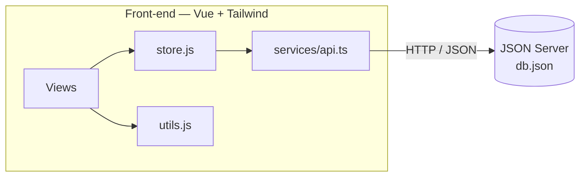
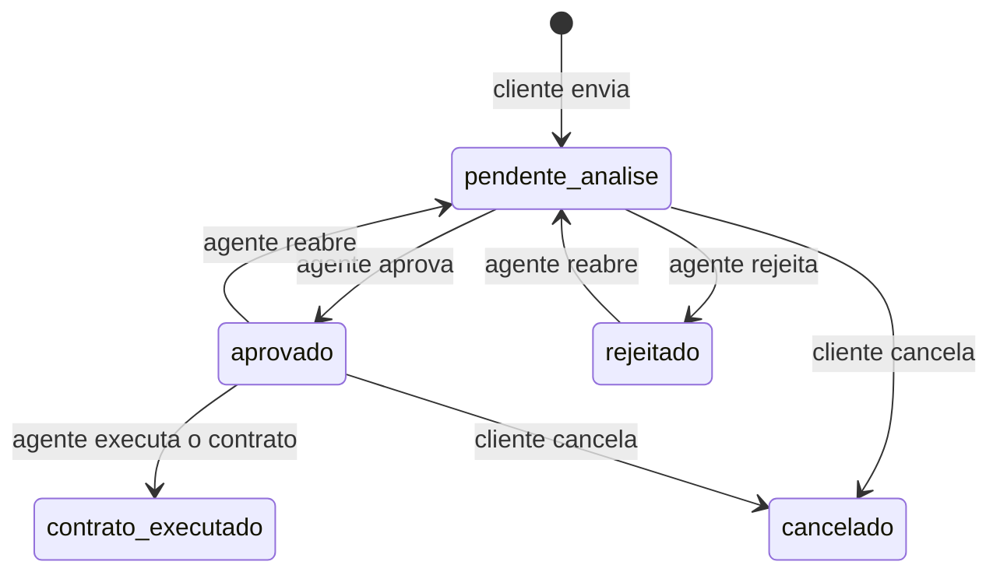

<<<<<<< HEAD
# 🚗 Alucarros — Gestão de Aluguéis de Automóveis 🔑

> [!NOTE]
> Sistema web para **efetuar, modificar, consultar e cancelar pedidos de aluguel de automóveis** pela Internet. Clientes fazem o pedido; agentes (bancos e empresas) analisam o perfil financeiro e conduzem o pedido até o contrato.

Este projeto foi desenvolvido como trabalho acadêmico de **Desenvolvimento de Interfaces Web**, a partir de um enunciado de requisitos: cadastro prévio obrigatório, dois perfis de usuário (cliente e agente), análise financeira dos pedidos e execução de contrato, com ou sem crédito bancário.

---

## 🚧 Status do Projeto


---

## 📚 Índice

- [Sobre o Projeto](#-sobre-o-projeto)
- [Funcionalidades Principais](#-funcionalidades-principais)
- [Tecnologias Utilizadas](#-tecnologias-utilizadas)
- [Arquitetura](#-arquitetura)
- [Instalação e Execução](#-instalação-e-execução)
- [Deploy](#-deploy)
- [Estrutura de Pastas](#-estrutura-de-pastas)
- [Demonstração](#-demonstração)
- [Testes](#-testes)
- [Documentações utilizadas](#-documentações-utilizadas)
- [Autores](#-autores)
- [Contribuição](#-contribuição)
- [Licença](#-licença)

---

## 📝 Sobre o Projeto

O **Alucarros** nasceu para apoiar a gestão de aluguéis de automóveis de ponta a ponta, sem papel e sem deslocamento: o cliente escolhe o grupo de veículo, informa retirada e devolução e envia o pedido; o agente avalia a renda do contratante, dá o parecer financeiro e, se for positivo, executa o contrato.

**Quem usa e para quê**

- **Cliente (usuário individual):** introduz, modifica, consulta e cancela pedidos de aluguel.
- **Agente (banco ou empresa):** avalia e modifica pedidos. Bancos também podem associar um **contrato de crédito** ao aluguel.

**Regras de negócio cobertas**

- O sistema só pode ser usado após **cadastro prévio**.
- Do contratante são armazenados RG, CPF, nome, endereço, profissão e as entidades empregadoras com os respectivos rendimentos (**máximo 3**).
- Dependendo do tipo de contrato, o automóvel pode ser registrado como propriedade do **cliente**, da **empresa** ou do **banco**.
- Do automóvel são registrados matrícula, ano, marca, modelo e placa.
- O sistema se divide em dois subsistemas: **gestão de pedidos e contratos** e **construção dinâmica das páginas web**.

---

## ✨ Funcionalidades Principais

- 🔐 **Cadastro e acesso por perfil:** cliente (com dados pessoais e até 3 empregadores) ou agente (banco ou empresa).
- 🚘 **Frota por grupos:** consulta de grupos de veículos com diária, carregados da API.
- 📝 **Pedido de aluguel:** retirada e devolução com validação de datas e cálculo automático de diárias e valor total.
- ✏️ **Modificar e cancelar pedido (cliente):** modificação enquanto o pedido está em análise; cancelamento mantém o histórico.
- 💼 **Análise financeira (agente):** visão do perfil do contratante com profissão, empregadores e renda total, com aprovação ou rejeição do pedido.
- 📑 **Execução de contrato:** após o parecer positivo, o agente define a propriedade do veículo (cliente, empresa ou banco) e, se for banco, associa crédito.
- 🔁 **Reabertura de análise:** o agente pode reverter uma decisão e voltar o pedido para análise.
- ⚠️ **Tratamento de erros:** avisos claros quando a API está fora do ar, com opção de tentar novamente.

---

## 🛠 Tecnologias Utilizadas

### 💻 Front-end

- **Framework:** Vue.js v3.5
- **Linguagem:** JavaScript ES6+ e TypeScript (camada de serviço)
- **Estilização:** Tailwind CSS v4 (tema configurado via `@theme` em `main.css`)
- **Gerenciamento de Estado:** `reactive` do Vue (store global simples em `store.js`)
- **Build Tool:** Vite v8

### 🖥️ Back-end (simulado)

- **API REST:** [JSON Server](https://github.com/typicode/json-server) v1 (beta), lendo e gravando o arquivo `db.json`
- **Banco de dados:** `db.json` (coleções `usuarios`, `grupos`, `automoveis` e `pedidos`)

### ⚙️ Qualidade

- **Lint e formatação:** ESLint, Oxlint e Prettier
- **Testes:** Vitest (unitários) e Playwright (E2E)

---

## 🏗 Arquitetura

O front-end é uma **SPA** em Vue. A navegação é controlada pela `store` (`viewAtual`) e a camada `services/api.ts` concentra toda a comunicação HTTP com a API.



**Subsistemas previstos no enunciado**

| Subsistema | Onde está |
|:--|:--|
| Gestão de pedidos e contratos | `store.js`, `services/api.ts` e `db.json` |
| Construção dinâmica das páginas web | `App.vue` e `views/` (a tela é escolhida conforme o perfil e o estado) |

**Ciclo de vida de um pedido**



**Decisões importantes**

- O vínculo entre pedido e cliente é feito no front-end (`pedido.clienteId` com `usuarios.id`), porque o JSON Server 1.x não aceita o antigo `_expand`.
- O **cancelamento** altera o status em vez de apagar o pedido, preservando o histórico.
- O login seleciona um perfil existente, **sem senha**. Isso serve ao protótipo acadêmico e não substitui uma autenticação real.

---

## 🔧 Instalação e Execução

### Pré-requisitos

- **Node.js:** `^22.18.0` ou `>=24.12.0`
- **Gerenciador de pacotes:** npm

### 🔑 Variáveis de Ambiente

Opcional. Crie um arquivo `.env.local` na raiz para apontar para outra API:

| Variável | Descrição | Padrão |
|:--|:--|:--|
| `VITE_API_URL` | URL base da API | `http://localhost:3000` |

### 📦 Instalação de Dependências

```bash
git clone <URL_DO_SEU_REPOSITORIO>
cd auto-rent-system
npm install
```

### ⚡ Como Executar a Aplicação

Execute em **dois terminais separados**.

**Terminal 1: API (JSON Server)**

```bash
npm run api
```

🚀 *A API estará em [http://localhost:3000](http://localhost:3000).*

**Terminal 2: Front-end (Vite)**

```bash
npm run dev
```

🎨 *O front-end estará em [http://localhost:5173](http://localhost:5173).*

> [!TIP]
> Se as telas aparecerem vazias ou com aviso de erro, confirme se o **Terminal 1** está rodando. Sem a API, nada é carregado.

---

## 🚀 Deploy

1. **Build do front-end:**

```bash
npm run build
```

Os arquivos estáticos são gerados em `dist/`.

2. **Publicação:** sirva a pasta `dist/` em qualquer host estático (Vercel, Netlify, Nginx etc.). Para testar localmente:

```bash
npm run preview
```

> [!WARNING]
> O JSON Server serve apenas para desenvolvimento e demonstração. Em produção, substitua-o por um back-end real e ajuste `VITE_API_URL`.

---

## 📂 Estrutura de Pastas

```
.
├── db.json                  # 💾 Banco de dados simulado (usuarios, grupos, automoveis, pedidos).
├── index.html               # 🌐 Página base da aplicação.
├── package.json             # 📦 Dependências e scripts.
├── vite.config.ts           # ⚙️ Configuração do Vite + Tailwind.
├── public/                  # 📂 Arquivos estáticos (opcional: fotos dos carros).
└── src/
    ├── main.ts              # 🚪 Ponto de entrada da aplicação.
    ├── App.vue              # 🧭 Cabeçalho e escolha da tela conforme perfil e estado.
    ├── store.js             # 🧠 Estado global: sessão, navegação e pedidos.
    ├── utils.js             # 🛠️ Moeda, datas, diárias, validação e rótulos de status.
    ├── assets/
    │   └── main.css         # 🎨 Tailwind, tema (cores e fontes) e componentes visuais.
    ├── services/
    │   └── api.ts           # 🔌 Chamadas HTTP à API.
    └── views/
        ├── HomeView.vue         # 🚘 Busca de datas e frota.
        ├── LoginView.vue        # 🔐 Acesso e cadastro (cliente ou agente).
        ├── CriarPedidoView.vue  # 📝 Criação e modificação de pedido.
        ├── ClienteDashboard.vue # 📋 Reservas do cliente.
        └── AgenteDashboard.vue  # 💼 Painel de análise e contratos.
```

---

## 🎥 Demonstração

> Adicione aqui os prints das telas principais (hospede as imagens no GitHub Pages ou em um CDN).

| Tela | Captura de Tela |
|:--|:--|
| **Home e frota** | *Seu print aqui* |
| **Login e cadastro** | *Seu print aqui* |
| **Finalizar reserva** | *Seu print aqui* |
| **Minhas reservas (cliente)** | *Seu print aqui* |
| **Painel de análise (agente)** | *Seu print aqui* |

### 💻 Exemplo de chamada à API

```bash
curl http://localhost:3000/pedidos
```

**Saída esperada (resumida):**

```json
[
  {
    "id": "LTJQ5ebykTY",
    "clienteId": "1",
    "status": "pendente_analise",
    "valorTotal": 444,
    "agenteAvaliadorId": null,
    "contratoCreditoId": null
  }
]
```

---

## 🧪 Testes

Os scripts já estão configurados no `package.json`:

```bash
npm run test:unit   # Vitest
npm run test:e2e    # Playwright
```

Antes de enviar alterações, rode também:

```bash
npm run lint
npm run type-check
```

---

## 🔗 Documentações utilizadas

- 📖 **Vue.js:** [vuejs.org](https://vuejs.org/guide/introduction.html)
- 📖 **Vite:** [vitejs.dev](https://vitejs.dev/config/)
- 📖 **Tailwind CSS v4:** [tailwindcss.com/docs](https://tailwindcss.com/docs)
- 📖 **JSON Server:** [github.com/typicode/json-server](https://github.com/typicode/json-server)
- 📖 **Padrão de commits:** [Conventional Commits](https://www.conventionalcommits.org/en/v1.0.0/)

---
=======
# auto-rent-system

This template should help get you started developing with Vue 3 in Vite.

## Recommended IDE Setup

[VS Code](https://code.visualstudio.com/) + [Vue (Official)](https://marketplace.visualstudio.com/items?itemName=Vue.volar) (and disable Vetur).

## Recommended Browser Setup

- Chromium-based browsers (Chrome, Edge, Brave, etc.):
  - [Vue.js devtools](https://chromewebstore.google.com/detail/vuejs-devtools/nhdogjmejiglipccpnnnanhbledajbpd)
  - [Turn on Custom Object Formatter in Chrome DevTools](http://bit.ly/object-formatters)
- Firefox:
  - [Vue.js devtools](https://addons.mozilla.org/en-US/firefox/addon/vue-js-devtools/)
  - [Turn on Custom Object Formatter in Firefox DevTools](https://fxdx.dev/firefox-devtools-custom-object-formatters/)

## Type Support for `.vue` Imports in TS

TypeScript cannot handle type information for `.vue` imports by default, so we replace the `tsc` CLI with `vue-tsc` for type checking. In editors, we need [Volar](https://marketplace.visualstudio.com/items?itemName=Vue.volar) to make the TypeScript language service aware of `.vue` types.

## Customize configuration

See [Vite Configuration Reference](https://vite.dev/config/).

## Project Setup

```sh
npm install
```

### Compile and Hot-Reload for Development

```sh
npm run dev
```

### Type-Check, Compile and Minify for Production

```sh
npm run build
```

### Run Unit Tests with [Vitest](https://vitest.dev/)

```sh
npm run test:unit
```

### Run End-to-End Tests with [Playwright](https://playwright.dev)

```sh
# Install browsers for the first run
npx playwright install

# When testing on CI, must build the project first
npm run build

# Runs the end-to-end tests
npm run test:e2e
# Runs the tests only on Chromium
npm run test:e2e -- --project=chromium
# Runs the tests of a specific file
npm run test:e2e -- tests/example.spec.ts
# Runs the tests in debug mode
npm run test:e2e -- --debug
```

### Lint with [ESLint](https://eslint.org/)

```sh
npm run lint
```
>>>>>>> 66053c1 (primeiro commit)
